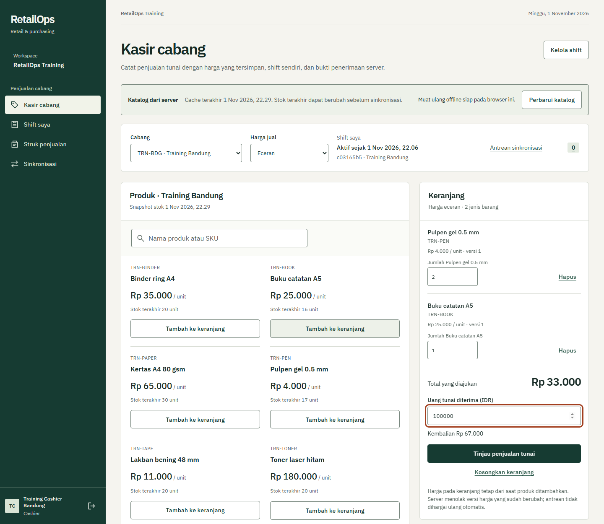
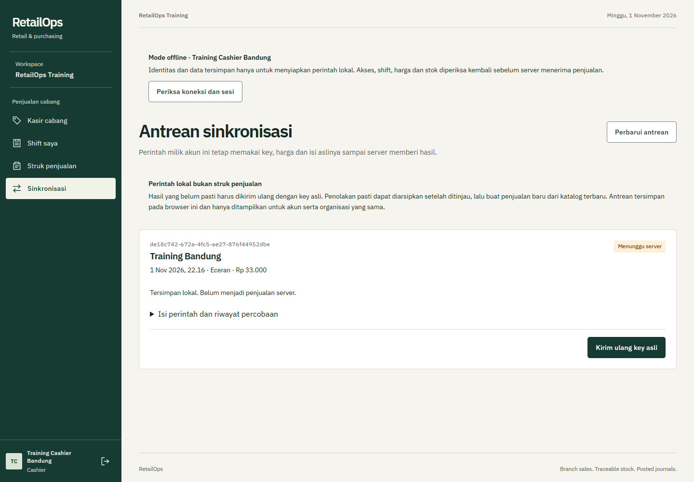
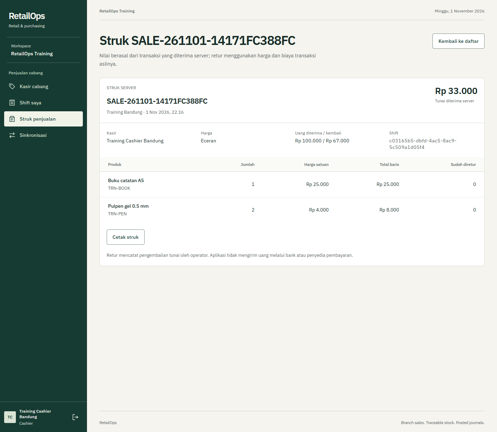
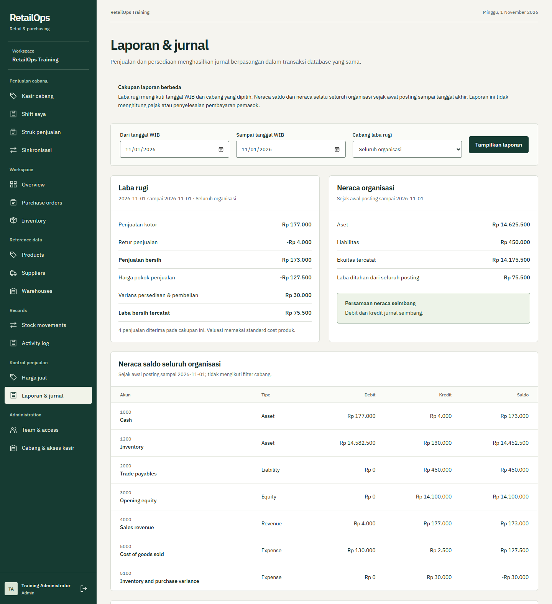
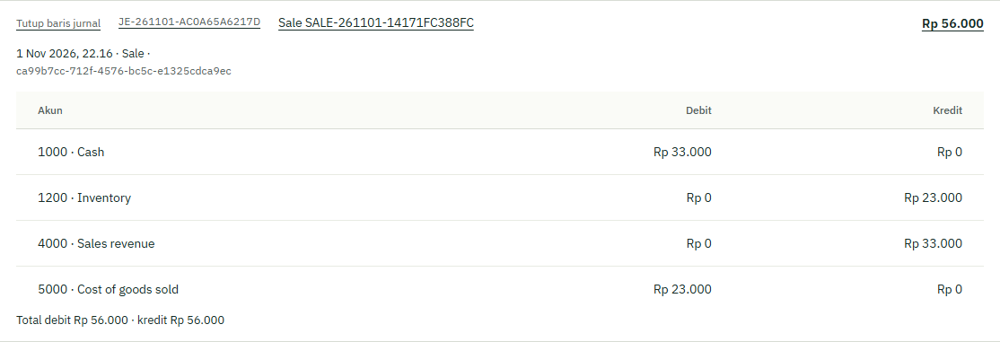
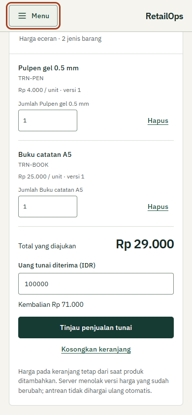
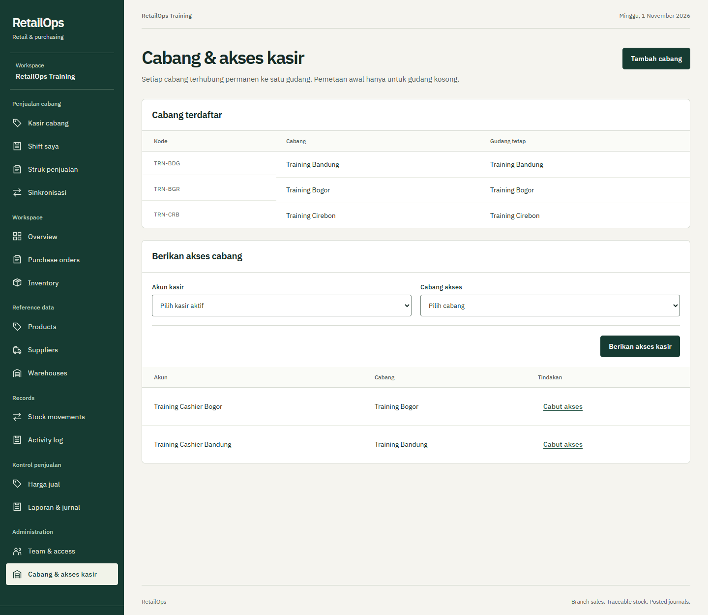

# RetailOps

POS multicabang dengan stok transaksional, antrean penjualan offline, pembelian, retur kas, dan jurnal debit-kredit dalam satu aplikasi. Backend memakai .NET 10/EF Core 10/PostgreSQL 18, sedangkan antarmuka memakai React 19 dan TypeScript.

Saat koneksi terputus, kasir menyimpan perintah penjualan di IndexedDB. Setelah terhubung, server memeriksa kembali akun, cabang, shift, harga dan stok. Perintah yang belum jelas hasilnya memakai key yang sama saat dicoba lagi. Nomor struk baru dianggap sah setelah server mengonfirmasi transaksi.



Screenshot berasal dari aplikasi yang dijalankan dengan data **Training sintetis**. Tidak ada transaksi pelanggan, password, atau saldo bisnis nyata pada gambar.

<details>
<summary>Lihat antrean offline, struk, jurnal dan versi ponsel</summary>

Perintah tersimpan saat browser benar-benar offline, sebelum server menerimanya:



Setelah koneksi pulih, key yang sama menghasilkan struk server:



Laporan memisahkan laba rugi periode dari neraca organisasi:



Satu sale mempunyai posting kas, pendapatan, COGS dan inventory yang seimbang:



Keranjang dan pembayaran tetap dapat dipakai pada layar390 piksel:



Admin menghubungkan cabang ke gudang dan memberikan akses kasir:



</details>

## Jalankan

Prasyarat: Docker Desktop dengan Linux containers dan PowerShell. Port aplikasi 8150 dan PostgreSQL 5450 harus tersedia. Source, cache pengembangan dan dokumentasi dapat disimpan di D:; lokasi volume Docker mengikuti pengaturan disk Docker Desktop.

```powershell
git clone https://github.com/zalamanga/retailops.git
cd retailops
.\scripts\Start.ps1
```

Buka **http://127.0.0.1:8150**. Startup membuat password database acak dalam `.env` yang diabaikan Git, menjalankan migrasi, lalu menyalakan aplikasi. Workspace baru kosong: buat organisasi dan administrator melalui halaman awal.

```powershell
.\scripts\Stop.ps1
```

Stop mempertahankan database dan session-key volume. Penghapusan volume bukan prosedur restart.

## Urutan konfigurasi pertama

Untuk workspace latihan yang masih kosong, data sintetis opsional dapat dibuat dengan Python 3 tanpa dependency tambahan:

```powershell
python scripts/seed-demo.py --confirm-synthetic
```

Tool hanya menargetkan RetailOps loopback port 8150, menolak workspace yang sudah ada tanpa checkpoint miliknya, dan menyimpan password acak di `.local/LOCAL-CREDENTIALS.txt`. Jika hasil sebuah langkah tidak pasti, tool berhenti untuk pemeriksaan dan tidak mengulang mutation non-idempoten secara otomatis. Tidak ada akun/password demo bawaan pada startup normal.

1. Tambahkan produk dengan SKU, satuan, reorder point dan standard cost.
2. Buat gudang, lalu hubungkan gudang yang masih kosong ke cabang.
3. Tambahkan stok melalui penyesuaian yang mempunyai alasan, atau melalui PO yang disetujui orang lain dan diterima.
4. Atur harga Retail/Wholesale serta batas jumlah grosir.
5. Buat akun Cashier dan berikan akses cabang. Admin/Manager adalah peran back-office pusat.
6. Kasir memilih cabang, membuka shift, lalu memuat katalog POS saat online.
7. Simpan penjualan dan periksa status antrean/struk. Manager dapat mencatat retur memakai shift miliknya di cabang yang sama.
8. Periksa jurnal serta laporan. Neraca dan trial balance meliputi organisasi sampai tanggal akhir; laba-rugi dapat difilter menurut periode dan cabang.

## Alur yang ditangani

| Bagian | Perilaku |
|---|---|
| Pembelian | PO, persetujuan oleh orang lain, penerimaan parsial, receipt idempoten dan audit |
| Inventory | Kuantitas utuh, transfer gudang, penyesuaian beralasan, saldo tidak negatif |
| Cabang dan harga | Satu gudang per cabang, assignment Cashier, harga Retail/Wholesale dengan version check |
| Kasir | Shift pribadi, keranjang, pembayaran kas tercatat, kembalian dan struk server |
| Offline | App shell tersimpan setelah load online, katalog dan perintah lokal terpisah per identitas |
| Sinkronisasi | Key/payload tetap saat hasil belum pasti; harga/stok/akses yang ditolak menjadi konflik untuk ditinjau |
| Retur | Kuantitas kumulatif dibatasi jumlah terjual; harga penjualan dan COGS asli tetap menjadi rujukan |
| Akuntansi | Jurnal otomatis dari receipt, adjustment, transfer, penjualan dan retur; keseimbangan diperiksa PostgreSQL saat commit |

## Apa arti offline di sini?

Perangkat perlu memuat aplikasi, akun, katalog dan shift saat online terlebih dahulu. Katalog lokal adalah snapshot, bukan jaminan stok yang masih tersedia. Penjualan tertunda belum mengurangi stok server dan belum mempunyai struk server. Harga berubah, stok habis, shift ditutup atau assignment dicabut dapat membuat sinkronisasi ditolak.

Perintah ditulis ke IndexedDB sebelum POST. Ketika koneksi gagal setelah server mungkin sudah commit, antrean mengirim ulang identitas yang sama. Login pengguna berbeda tidak boleh melihat atau mengirim antrean pemilik sebelumnya. Menutup browser tidak sama dengan membatalkan perintah; menghapus data browser dapat menghilangkan perintah yang belum tersinkron.

Jika percobaan sebelumnya belum jelas hasilnya, penolakan akses pada percobaan berikutnya belum membuktikan penjualan awal gagal. Aplikasi mempertahankan perintah asli untuk rekonsiliasi dan tidak menawarkan pembuangan yang dapat menyebabkan penjualan ganda.

## Dasar jurnal

Persediaan dinilai dengan standard cost. Penerimaan mencatat utang pada biaya PO aktual dan selisihnya pada akun variance. Penjualan mencatat kas/pendapatan sekaligus COGS/persediaan. Retur membalik harga serta COGS penjualan asli; jika standard cost berubah setelah stok habis, selisih nilai persediaan yang kembali dicatat sebagai variance tersendiri.

Saldo pembuka shift dan selisih hitungan kas adalah catatan operasional drawer. Keduanya tidak otomatis menjadi setoran modal atau jurnal koreksi kas. Neraca menunjukkan transaksi yang sudah diposting. Proyek ini tidak menghitung pajak, memproses transfer payment gateway, atau menyelesaikan pembayaran supplier.

## Pengembangan dan pengujian

SDK dipatok pada [global.json](global.json); Node.js 22.12+ diperlukan untuk frontend. Di komputer pengembangan ini, SDK dan cache NuGet berada di D:. Script juga dapat menemukan SDK yang dipasang pengguna melalui PATH atau `RETAILOPS_DOTNET`.

```powershell
.\scripts\dev.ps1
.\scripts\test.ps1
.\scripts\build.ps1
```

Test backend memakai PostgreSQL sungguhan dan database sementara berawalan `retailops_test_`. Jangan mengarahkan koneksi test ke database kerja. Pengujian offline harus memakai frontend hasil build yang dilayani API, bukan Vite development server. Hasil dan batas verifikasi dicatat di [VERIFICATION](docs/VERIFICATION.md).

[CI final](https://github.com/zalamanga/retailops/actions/runs/41322384020) lulus: **76 backend, 36 unit frontend, 10 skenario browser**, pemeriksaan hak database runtime, serta build image Docker. Screenshot README juga berasal dari Docker yang dijalankan secara lokal.

## Panduan

- [Tutorial per file dan function](docs/PANDUAN-KODE.md)
- [Arsitektur dan konsistensi data](docs/ARCHITECTURE.md)
- [Alur pembelian, kasir dan sinkronisasi](docs/FLOWCHARTS.md)
- [Kontrak REST API](docs/API.md)
- [Kebutuhan produk dan batas cakupan](docs/PRD.md)
- [Deployment dan penyimpanan](docs/DEPLOYMENT.md)
- [Asal source dan penggunaan kembali kode](docs/ORIGIN.md)
- [Bukti verifikasi](docs/VERIFICATION.md) dan [review UI](docs/DELIVERY-GATE.md)

Fondasi pembelian berasal dari StockPilot milik pemilik repo; aturan transaksi baru diimplementasikan dalam backend C# yang sama. Data, password dan database proyek asal tidak disalin.
