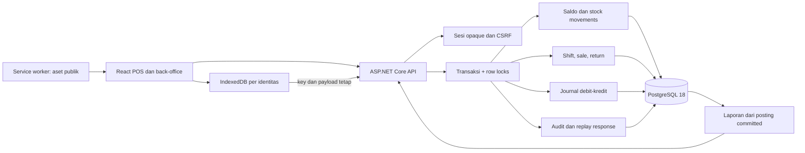

# Arsitektur dan konsistensi

## Transaksi

HTTP adalah batas masukan, bukan sumber kebenaran harga, jumlah total atau COGS. API memeriksa role/assignment, mengunci shift dan record stok dalam urutan yang stabil, lalu menulis efek domain dan bukti idempotensi dalam transaksi yang sama. Unique keys dan check constraints melengkapi pemeriksaan aplikasi. Respons replay tidak menjalankan ulang efek.

Pemakaian EF Core tidak menggantikan penguncian domain. Beberapa operasi memerlukan beberapa query dan SaveChanges dalam satu transaksi eksplisit. Lihat [dokumentasi transaksi EF Core](https://learn.microsoft.com/en-us/ef/core/saving/transactions).

## Antrean offline

IndexedDB menyimpan perintah sebelum fetch. Partisi memakai organizationId, userId dan branchId; token autentikasi/CSRF tidak disimpan. Cache app shell hanya berisi aset publik hasil build. Service worker tidak menjadi cache umum endpoint API. Sebelum replay, aplikasi memastikan identitas online masih merupakan pemilik antrean.

Pengiriman berulang dapat terjadi setelah crash, lease habis atau hasil jaringan tidak pasti. Server tetap mempertahankan efek tunggal melalui key dan fingerprint dalam database. Claim lokal membantu koordinasi tab; ia bukan pengganti idempotensi server. Konflik stok/harga/shift/akses mempunyai status tersendiri dan tidak dianggap sukses.

Siklus install/activate dan cache worker mengikuti [Service Worker API](https://developer.mozilla.org/en-US/docs/Web/API/Service_Worker_API/Using_Service_Workers). Pengujian harus memuat production build, memutus koneksi browser, reload, lalu memulihkan koneksi dan memeriksa bukti server.

## Akuntansi

Journal memakai sumber unik, header/line immutable dan constraint keseimbangan yang ditunda sampai commit. Ini memungkinkan beberapa line ditambahkan dalam transaksi yang sama, tetapi menolak posting yang belum lengkap ketika transaksi selesai. Cost produk tidak boleh berubah selama stok masih ada. Sale menyimpan snapshot harga serta cost; retur membalik snapshot asli dan memakai variance ketika nilai persediaan saat ini berbeda.

Trial balance/neraca menghitung seluruh posting organisasi sampai tanggal akhir. P&L memakai periode WIB dan dapat dibatasi cabang. Nilai laba ditahan direkonsiliasi dari akun pendapatan/biaya, bukan disalin dari tabel penjualan. Label laporan harus menunjukkan perbedaan cakupan tersebut.

## Isolasi operasional

Compose menggunakan project `retailops`, volume baru dan port loopback tersendiri. Migrator dan runtime mempunyai peran berbeda pada konfigurasi deployment; secret/key tidak masuk source. Runtime tidak seharusnya mempunyai hak membuat schema. Backup dan pemulihan harus mempertahankan database serta Data Protection keys. Repo sumber StockPilot dan database proyek lain tidak menjadi target startup/test RetailOps.
