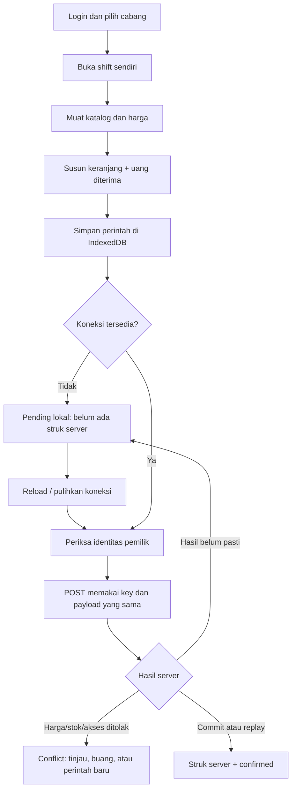

# Alur aplikasi



```mermaid
sequenceDiagram
  participant C as Kasir
  participant API as Retail API
  participant DB as PostgreSQL
  C->>API: Sale + Idempotency-Key
  API->>DB: Begin; cek replay dan current access
  API->>DB: Lock shift, product/price, inventory
  API->>DB: Validasi harga, kuantitas dan cash
  API->>DB: Sale + stock movement + audit + journal + replay result
  DB->>DB: Deferred debit-credit validation
  DB-->>API: Commit
  API-->>C: Struk server
  C->>API: Retry dengan key/payload sama
  API-->>C: Hasil tersimpan, tanpa perubahan stok tambahan
```

## Pembelian

Admin/Operator menyiapkan PO, kemudian orang lain dengan role Manager/Admin memberi persetujuan. Penerimaan mengunci order dan posisi stok, memeriksa sisa kuantitas dan key penerimaan, lalu menulis receipt, stok, journal dan audit bersama. Standard cost dan biaya supplier dapat berbeda; selisih harga masuk akun variance.

## Retur

Manager/Admin membuka shift sendiri di cabang penjualan. Permintaan retur menyebut line sale dan kuantitas. Server menserialkan pemeriksaan retur kumulatif terhadap jumlah terjual, mengembalikan stok dan membalik harga/COGS asli. Jika standard cost berubah setelah stok sebelumnya habis, variance menghubungkan nilai stok saat ini dengan reversal COGS asli. Permintaan berulang memakai key tetap.

## Menutup shift

Kasir menghitung kas fisik. Server mengunci shift terhadap penjualan/retur yang bersamaan, menghitung opening + sales - refunds, lalu mencatat kas terhitung dan selisih. Perintah sale baru tidak boleh masuk ke shift tertutup. Replay atas sale yang sudah commit tetap mengembalikan struk asli, dengan otorisasi terkini.
